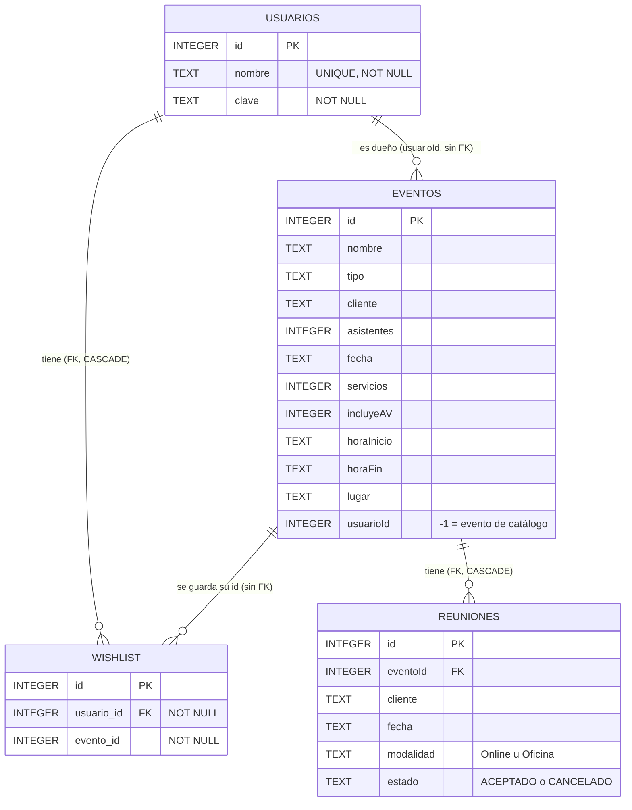

# Esquema de la base de datos

La app usa **dos bases de datos**:

- **SQLite** (`eventogo.db`, clase `EventosDB`, versión 2): `usuarios` y `wishlist`.
- **Room** (`eventogo_room.db`, clase `AppDatabase`): `eventos` y `reuniones`.

Como están en bases distintas, SQLite no puede poner una clave ajena hacia Room. Por eso la `wishlist` guarda solo el **id del evento** y el evento se busca por su id en Room, y el dueño de un evento se guarda como un número (`usuarioId`).

## Diagrama

## Tablas

### SQLite: `usuarios`
Un usuario por fila. `nombre` es único. Al crear la base se insertan `admin` (id 1) y `carlos` (id 2).

### SQLite: `wishlist`
La lista personal de cada usuario. `UNIQUE(usuario_id, evento_id)` evita guardar dos veces el mismo evento. La clave ajena `usuario_id` tiene `ON DELETE CASCADE`: si se borra un usuario, desaparece su lista.

### Room: `eventos` (clase `Evento`)
Un evento por fila. `usuarioId` es el id del dueño; vale `-1` para los eventos de catálogo (ejemplos que no son de nadie).

### Room: `reuniones` (clase `ReunionEvento`)
Relación **1-N** con `eventos`: un evento puede tener varias reuniones. La clave ajena `eventoId` tiene `onDelete = CASCADE`: al borrar un evento, Room borra solo sus reuniones. Lleva un índice sobre `eventoId`.

## Consultas fuera del hilo principal

Todas las consultas van en un hilo aparte (`AppDatabase.ejecutor`) y las vistas solo se tocan después, en el hilo principal con `runOnUiThread`.

## Carga inicial

`DatosIniciales` se ejecuta al abrir la app. Si la base de Room está vacía (instalación limpia), carga **20 eventos** (3 de admin, 3 de carlos y 14 de catálogo) y **2 reuniones** de ejemplo. Un valor guardado en `SharedPreferences` evita repetirla.
