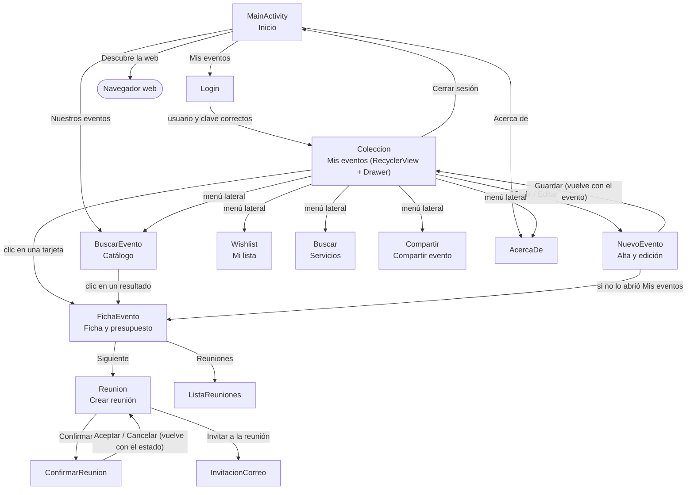

# Esquema de navegación

Pantallas (activities) de la app y cómo se llega de una a otra. Todas las pantallas tienen vuelta: el botón **Atrás** de la propia pantalla o el botón atrás del móvil, y las que devuelven un dato lo hacen con `ActivityResult`.

## Diagrama

## Diálogos

| Diálogo | Dónde se usa |
|---|---|
| `ConfirmarDialog` | Confirmar el borrado de un evento (`Coleccion`) o de una reunión (`ListaReuniones`) |
| `CuentaDialog` | Crear cuenta (`Login`), cambiar clave y eliminar la cuenta (menú lateral de `Coleccion`) |
| `SelectorFechaDialog` | Elegir fecha en `NuevoEvento` y `Reunion` |
| `SelectorHoraDialog` | Elegir hora de inicio y de fin en `NuevoEvento` |

## Menús

- **Menú lateral (Drawer), en `Coleccion`:** Mis eventos, Añadir evento, Catálogo de eventos, Mi lista, Buscar servicios, Compartir evento, Acerca de, Cambiar clave, Eliminar mi cuenta y Cerrar sesión.
- **Menú de opciones, en `Coleccion`:** Añadir evento, Ordenar por nombre, Buscar evento, Mi lista y Acerca de.
- **Menú contextual, en cada tarjeta (pulsación larga):** Editar y Eliminar.
